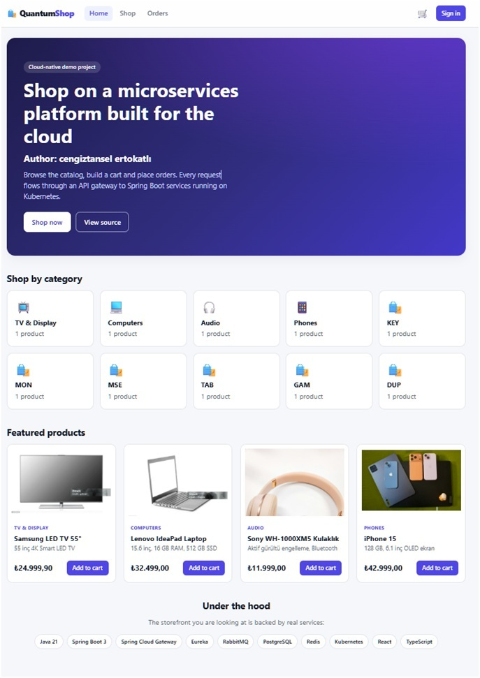
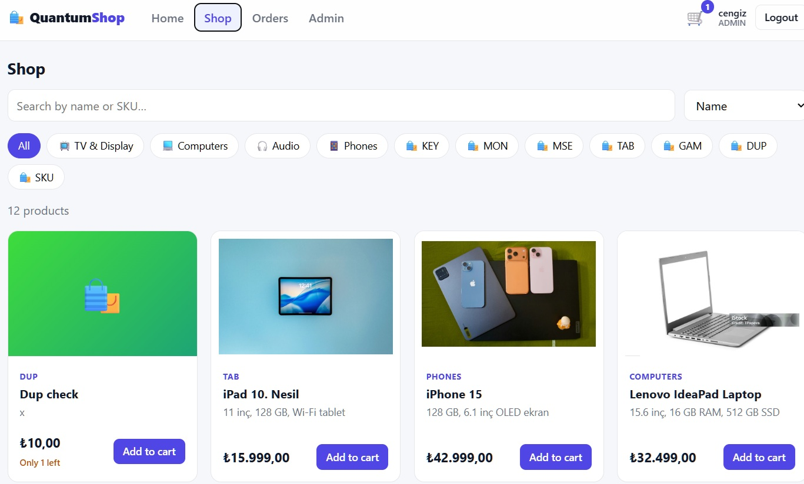
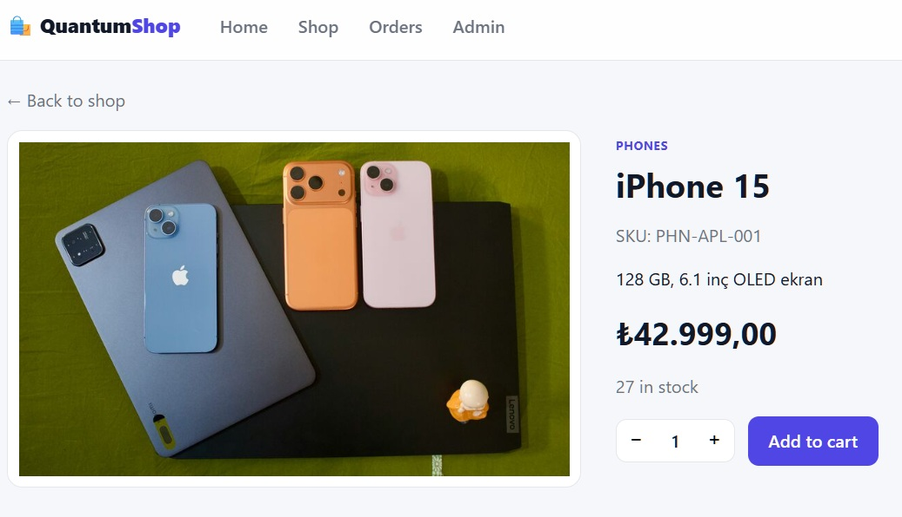
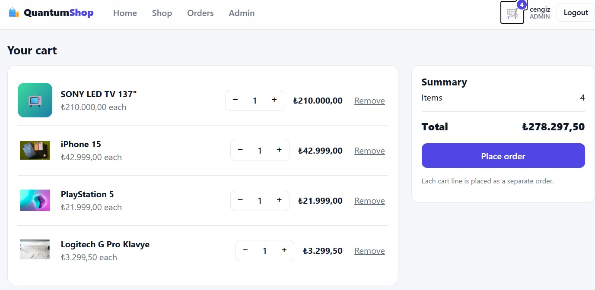
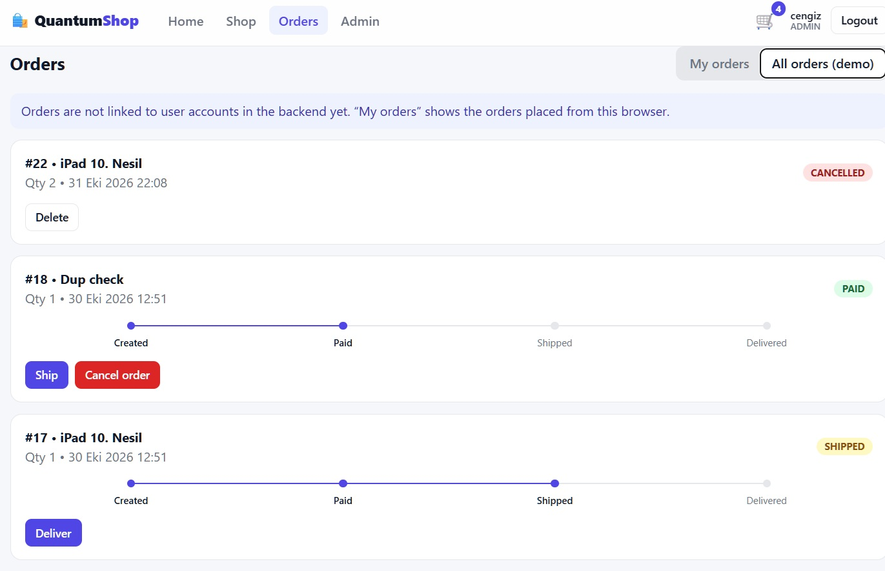
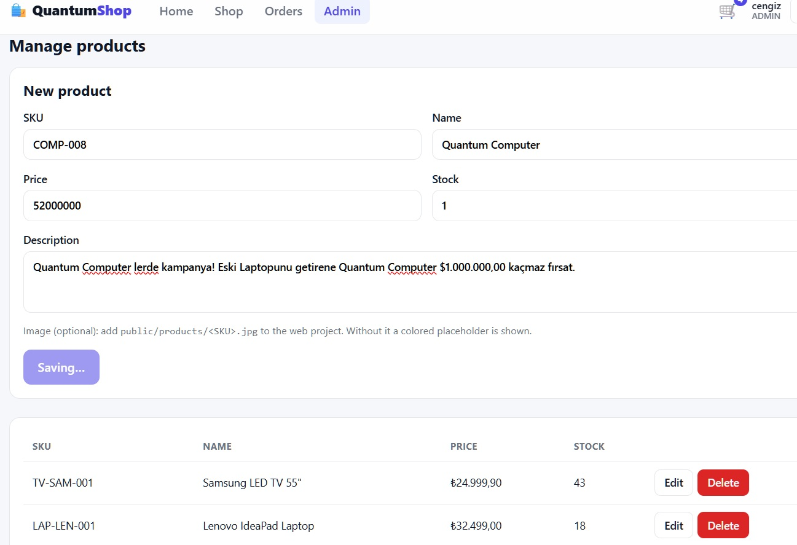
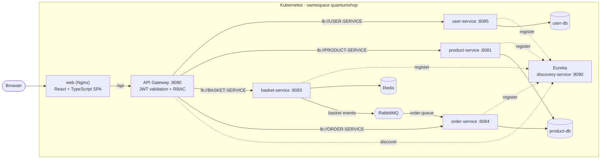
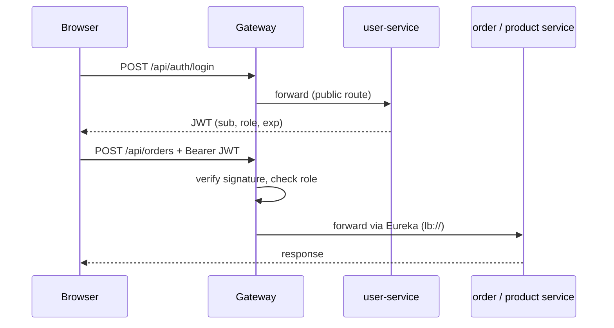
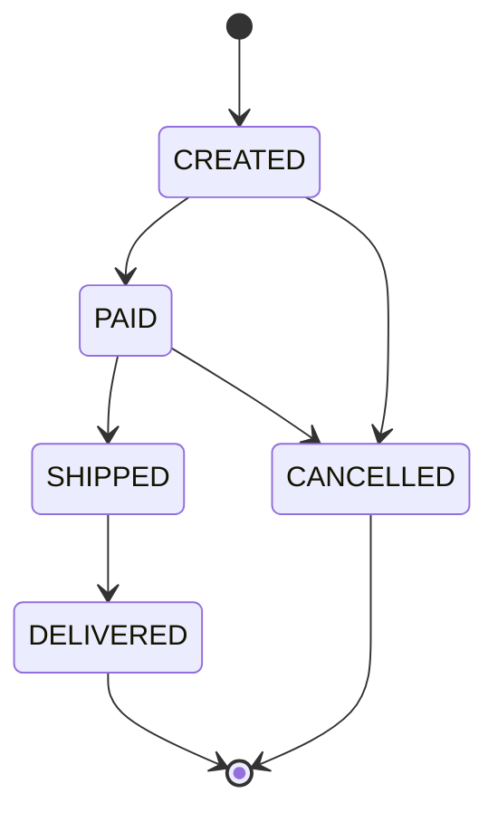

# QuantumShop: Cloud-Native E-Commerce on Kubernetes

A full-stack e-commerce demo: a **React + TypeScript** storefront served by **Nginx**, in front of a
**Spring Boot microservices** backend (API gateway, service discovery, JWT security with roles,
RabbitMQ events), all running on **Kubernetes**.

> Built to practice cloud-native architecture end to end. The [Challenges](#challenges-and-lessons-learned)
> section documents real problems hit on a small local cluster and how they were fixed.

## Screenshots

| | |
|---|---|
|  |  |
|  |  |
|  |  |

## Features

**Storefront**
- Home page, catalog with search, sorting and category filters, product details with images
- Shopping cart (kept in the browser), checkout that places orders, order tracking with a status stepper
- Sign in and registration, responsive layout (desktop, tablet, mobile)
- Admin area (ADMIN role): create, edit and delete products

**Backend**
- API gateway with JWT validation and role-based access control
- Service discovery with Eureka, client-side load balancing (`lb://`)
- Order lifecycle enforced by a state machine, RabbitMQ consumer for basket events
- Health probes, resource limits and manifests for every workload

## Architecture



## Services

| Service | Port | Responsibility | Storage |
|---|---|---|---|
| `web` | 8080 (Service 80) | Nginx serving the SPA, proxies `/api` to the gateway (same origin, no CORS needed) | - |
| `gateway-service` | 8090 | Single entry point, routing through Eureka, JWT validation, role checks | - |
| `discovery-service` | 9090 | Eureka service registry | - |
| `user-service` | 8085 | Users, registration and login, JWT issuing (BCrypt) | PostgreSQL (`user-db`) |
| `product-service` | 8081 | Product catalog CRUD, search and pagination (`/api/v1/products`) | PostgreSQL (`product-db`) |
| `basket-service` | 8083 | Shopping basket, publishes basket events | Redis, RabbitMQ |
| `order-service` | 8084 | Orders with a status workflow, consumes basket events | PostgreSQL (`product-db`)* |

Infrastructure: PostgreSQL, Redis, RabbitMQ (5672, management 15672), Adminer.
\* See [Known limitations](#known-limitations).

### Gateway routes and access rules

| Path | Target | Access |
|---|---|---|
| `/api/auth/**` | user-service | public |
| `GET /api/products/**` | product-service (rewritten to `/api/v1/products/**`) | public |
| `POST, PUT, PATCH, DELETE /api/products/**` | product-service | ADMIN |
| `/api/users/**` | user-service | authenticated |
| `/api/basket/**` | basket-service | authenticated |
| `/api/orders/**` | order-service | authenticated |
| `/api/admin/**` | user-service | ADMIN |

## Security

- `user-service` issues HMAC-signed JWTs (`sub` = username, `role` claim) after BCrypt password verification.
- The gateway verifies the signature on every request and applies the rules above. Invalid or missing tokens get `401`, insufficient role gets `403`.
- Enforcement can be switched off for debugging with `JWT_ENABLED=false` on the gateway.
- The signing key is **not** in the repository. It is created as a Kubernetes Secret shared by gateway and user-service (see Quick start).



## Order lifecycle

Invalid transitions return `409 Conflict`. An order can only be edited while `CREATED`, and only
`CREATED` or `CANCELLED` orders can be deleted.



`order-service` also consumes basket events from RabbitMQ (`basket.exchange` -> `order.queue`) and creates orders from them.

## Tech stack

- **Backend:** Java 21, Spring Boot 3.5, Spring Cloud (Gateway Server WebMVC, Netflix Eureka, LoadBalancer), Spring Data JPA, Spring Security (BCrypt), JJWT
- **Data and messaging:** PostgreSQL, Redis, RabbitMQ
- **Frontend:** React, TypeScript, Vite, React Router, plain CSS
- **Platform:** Docker, Kubernetes (Docker Desktop), Nginx, GitHub Actions, Maven

## Quick start (Kubernetes)

Prerequisites: Docker Desktop with Kubernetes enabled, `kubectl`, `openssl`, and about 8 GB of RAM.
JDK 21, Maven and Node are only needed to rebuild images. On a small machine the Java services need 2-5 minutes
to become ready; the probes are tuned for that.

```bash
# 1. Namespace and the JWT signing key (never committed)
kubectl apply -f k8s/namespace.yaml
kubectl create secret generic gateway-jwt-secret -n quantumshop \
  --from-literal=JWT_SECRET="$(openssl rand -base64 48)"

# 2. Infrastructure
kubectl apply -f k8s/config/ -f k8s/postgres/ -f k8s/redis/ -f k8s/rabbitmq/

# 3. Discovery first, then the backend services
kubectl apply -f k8s/discovery/
kubectl apply -f k8s/user/ -f k8s/product/ -f k8s/basket/ -f k8s/order/

# 4. Gateway and storefront
kubectl apply -f k8s/gateway/ -f k8s/web/

kubectl get pods -n quantumshop -w
```

When everything is `1/1 Running`, open the shop:

```bash
kubectl port-forward svc/web 3000:80 -n quantumshop
# http://localhost:3000
```

Database passwords in the manifests (`password123`) are **demo credentials** for a local cluster. Change them for any real deployment.

### Admin access

Registration always creates a `USER`. To get an admin, register in the UI, then:

```bash
./scripts/make-admin.sh <username>
```

Log out and back in (the role is part of the token). The **Admin** menu then appears.

## Try the API

```bash
TOKEN=$(curl -s -X POST localhost:3000/api/auth/register \
  -H "Content-Type: application/json" \
  -d '{"username":"demo","email":"demo@example.com","password":"Demo12345"}' \
  | sed -E 's/.*"token":"([^"]+)".*/\1/')

curl -s localhost:3000/api/products                       # public catalog

curl -s -X POST localhost:3000/api/orders \
  -H "Authorization: Bearer $TOKEN" -H "Content-Type: application/json" \
  -d '{"productName":"Wireless Headphones","quantity":2}'

curl -s -X PATCH localhost:3000/api/orders/1/status \
  -H "Authorization: Bearer $TOKEN" -H "Content-Type: application/json" \
  -d '{"status":"PAID"}'
```

## Frontend development

```bash
kubectl port-forward svc/gateway-service 8090:8090 -n quantumshop &
cd web && npm install && npm run dev      # open the URL Vite prints
```

The dev server proxies `/api` to the gateway, the same idea as the Nginx proxy in production.
Product images are optional static files named `web/public/products/<SKU>.jpg`; products without
one get a colored placeholder.

## Testing

`scripts/smoke-test.sh` is an end-to-end test that runs against the running system: registration and login,
the product catalog, the full order lifecycle including the rejected transitions, and (with `RBAC=1`) the
role rules, including an admin creating and deleting a product.

```bash
./scripts/smoke-test.sh http://localhost:3000
RBAC=1 ADMIN_USER=<admin> ADMIN_PASS=<password> ./scripts/smoke-test.sh http://localhost:3000
```

Each run registers a throwaway `smoke<timestamp>` user. GitHub Actions builds the web image on every change to `web/`.

## Challenges and lessons learned

Running ten JVM services on an 8 GB laptop surfaced real operational problems:

- **Slow cold starts killed healthy pods.** Spring Boot, Eureka and JPA took minutes to start under CPU limits, so the `startupProbe` budget ran out. Fixed with a generous `failureThreshold` and higher CPU limits.
- **Wrong probe port.** A copy-pasted probe pointed at another service's port, so every restart failed.
- **ConfigMaps and Secrets are read only at pod start.** Fixing a value did nothing until the pod was restarted.
- **Live objects drifted from manifests.** `kubectl set image/patch` changes were silently overwritten by the next `kubectl apply`. The manifests are now the single source of truth.
- **`Deployment.spec.selector` is immutable**, so changing it means deleting and recreating the Deployment.
- **`kubectl port-forward svc/...` pins to one pod**, so tunnels silently broke after rollouts.
- **A hard-coded property beat the environment variable**: the gateway registered with Eureka on the wrong port because a profile file hard-coded the URL.
- **A catch-all exception handler hid real errors.** It returned `500` without logging; handlers now log and map specific exceptions to 400/404/409.
- **Reactive vs servlet classpath.** A security config written for WebFlux crashed the servlet-based gateway with `NoClassDefFoundError`.
- **Database-per-service.** `user-service` was writing into the product database because of a copy-pasted JDBC URL; fixed.
- **A gateway filter turned downstream errors into 401.** The `try/catch` around the filter chain also caught exceptions from the services; only token parsing is inside it now.
- **SPA routing vs static images in Nginx.** `/products/14` (a UI route) and `/products/SKU.jpg` (an image) share a prefix; the Nginx rule matches image extensions only, so page reloads work and missing images return 404.
- **Laptop sleep and Docker restarts** leave JVM services in `CrashLoopBackOff` for several minutes until dependencies recover; the probes and restart behavior are tuned for it.

## Known limitations

- Orders are not linked to user accounts in the backend yet. The UI's "My orders" tab shows the orders placed from the current browser.
- `order-service` and `product-service` share one PostgreSQL instance (separate tables); a dedicated `order-db` is planned.
- Stock is checked in the UI only; `order-service` does not reserve or decrement stock.
- Each cart line becomes a separate order (the order model stores one product per order).
- The cart lives in the browser (`localStorage`); product images are static files in the web image.
- Authentication runs inside `user-service`; there is no standalone auth service.
- Test coverage is limited to the end-to-end smoke test; unit and integration tests are planned.
- Local single-node setup; no Ingress, TLS or autoscaling.

## Roadmap

- Link orders to users (gateway forwards the authenticated username, order-service stores and filters by it)
- Payment service communicating asynchronously over RabbitMQ
- Dedicated `order-db`, stock reservation
- Unit and integration tests in CI, probes for `order-service`
- Ingress with TLS

## Author

Cengiz Tansel - [github.com/cengiztansel](https://github.com/cengiztansel)

Portfolio project.
