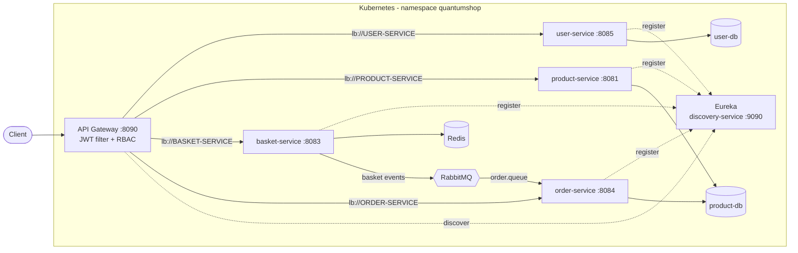
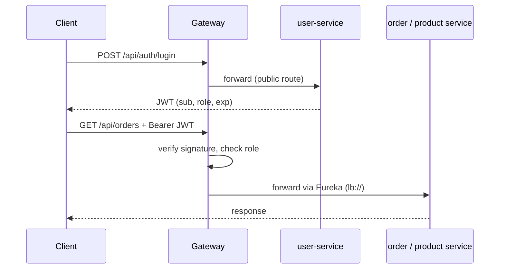
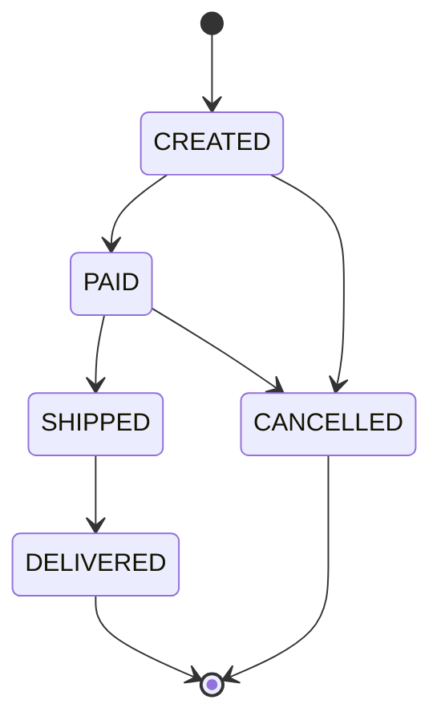

README.md:
markdown
# QuantumShop — Cloud-Native E-Commerce on Kubernetes

A microservices e-commerce backend built with **Java 21 and Spring Boot 3**, running on **Kubernetes**.
It covers what a real distributed system needs: an API gateway with JWT authentication and role checks,
service discovery, event-driven communication over RabbitMQ, per-service persistence and health probes.

> Built as a hands-on project to practice cloud-native architecture. The
> [Challenges](#challenges-and-lessons-learned) section documents real problems hit while running
> it on a small local cluster, and how they were fixed.

## Architecture



## Services

| Service | Port | Responsibility | Storage |
|---|---|---|---|
| `gateway-service` | 8090 | Single entry point, routing through Eureka, JWT validation, admin role check | - |
| `discovery-service` | 9090 | Eureka service registry | - |
| `user-service` | 8085 | User CRUD, registration and login, JWT issuing (BCrypt) | PostgreSQL (`user-db`) |
| `product-service` | 8081 | Product catalog CRUD and search (`/api/v1/products`) | PostgreSQL (`product-db`) |
| `basket-service` | 8083 | Shopping basket, publishes basket events | Redis, RabbitMQ |
| `order-service` | 8084 | Order CRUD with a status workflow, consumes basket events | PostgreSQL (`product-db`)* |

Infrastructure: PostgreSQL, Redis, RabbitMQ (5672, management 15672), Adminer (8080).
\* See [Known limitations](#known-limitations).

### Gateway routes

| Path | Target | Notes |
|---|---|---|
| `/api/auth/**` | user-service | public (login, register) |
| `/api/users/**` | user-service | |
| `/api/admin/**` | user-service | requires role `ADMIN` |
| `/api/products/**` | product-service | rewritten to `/api/v1/products/**` |
| `/api/basket/**` | basket-service | |
| `/api/orders/**` | order-service | |

## Security

- `user-service` issues HMAC-signed JWTs (`sub` = username, `role` claim) after BCrypt password verification.
- The gateway validates the signature on every request and enforces `ADMIN` for `/api/admin/**`.
- Enforcement is controlled by the `JWT_ENABLED` environment variable (the manifest defaults to `false` to make local demos easy; set it to `"true"` to enforce).
- The signing key is **not** stored in the repository. It is provided through a Kubernetes Secret shared by gateway and user-service.



## Order lifecycle

Orders follow a small state machine. Invalid transitions return `409 Conflict`; an order can only be
edited while `CREATED`, and only `CREATED` or `CANCELLED` orders can be deleted.



`order-service` also consumes basket events from RabbitMQ (`basket.exchange` -> `order.queue`) and creates orders from them.

## Tech stack

Java 21, Spring Boot 3.5, Spring Cloud (Gateway Server WebMVC, Netflix Eureka, LoadBalancer),
Spring Data JPA, Spring Security (BCrypt), JJWT, PostgreSQL, Redis, RabbitMQ,
Docker, Docker Compose, Kubernetes (Docker Desktop), GitHub Actions, Maven.

## Quick start (Kubernetes)

Prerequisites: Docker Desktop with Kubernetes enabled, `kubectl`, and about 8 GB of RAM.
JDK 21 and Maven are only needed to rebuild images. Services take 2-5 minutes to become ready on a small machine; the probes are tuned for that.

```bash
# 1. Namespace and the JWT signing key (never committed)
kubectl apply -f k8s/namespace.yaml
kubectl create secret generic gateway-jwt-secret -n quantumshop \
  --from-literal=JWT_SECRET="$(openssl rand -base64 48)"

# 2. Infrastructure
kubectl apply -f k8s/config/ -f k8s/postgres/ -f k8s/redis/ -f k8s/rabbitmq/

# 3. Discovery first, then the services, gateway last
kubectl apply -f k8s/discovery/
kubectl apply -f k8s/user/ -f k8s/product/ -f k8s/basket/ -f k8s/order/
kubectl apply -f k8s/gateway/

kubectl get pods -n quantumshop -w
```

Database passwords in the manifests (`password123`) are **demo credentials** for a local cluster. Change them for any real deployment.

## Try it

```bash
kubectl port-forward svc/gateway-service 8090:8090 -n quantumshop &

# Register and capture the token
TOKEN=$(curl -s -X POST localhost:8090/api/auth/register \
  -H "Content-Type: application/json" \
  -d '{"username":"demo","email":"demo@example.com","password":"Demo12345"}' \
  | sed -E 's/.*"token":"([^"]+)".*/\1/')

# Browse products
curl -s localhost:8090/api/products -H "Authorization: Bearer $TOKEN"

# Create an order, then move it through the workflow
curl -s -X POST localhost:8090/api/orders \
  -H "Authorization: Bearer $TOKEN" -H "Content-Type: application/json" \
  -d '{"productName":"Wireless Headphones","quantity":2}'

curl -s -X PATCH localhost:8090/api/orders/1/status \
  -H "Authorization: Bearer $TOKEN" -H "Content-Type: application/json" \
  -d '{"status":"PAID"}'
```

## Challenges and lessons learned

Running ten JVM services on an 8 GB laptop surfaced real operational problems:

- **Slow cold starts killed healthy pods.** Spring Boot + Eureka + JPA took minutes to start under CPU limits, so the `startupProbe` budget ran out. Fixed with a generous `failureThreshold` and a higher CPU limit.
- **Wrong probe port.** A copy-pasted probe pointed at another service's port, so every restart failed. Probes now match each service's port.
- **ConfigMaps and Secrets are read only at pod start.** Fixing a value did nothing until the pod was restarted.
- **Live objects drifted from manifests.** `kubectl set image/patch` changes were silently overwritten by the next `kubectl apply`. The manifests are now the single source of truth.
- **`Deployment.spec.selector` is immutable**, so changing it requires deleting and recreating the Deployment.
- **`kubectl port-forward svc/...` pins to one pod**, so tunnels silently broke after rollouts.
- **A hard-coded property beat the environment variable**: the gateway registered with Eureka on the wrong port because the profile file hard-coded the URL.
- **A catch-all exception handler hid real errors.** It returned `500` without logging; handlers now log and map specific exceptions to proper status codes (400/404/409).
- **Reactive vs servlet classpath.** A security config written for WebFlux crashed a servlet-based gateway with `NoClassDefFoundError`.
- **Database-per-service.** `user-service` was writing into the product database because of a copy-pasted JDBC URL; fixed.

## Known limitations

- `order-service` and `product-service` currently share one PostgreSQL instance (separate tables). A dedicated `order-db` is planned.
- Authentication runs inside `user-service`; a standalone auth service is out of scope for now.
- Test coverage is limited; automated tests for the order state machine are planned.
- Local single-node setup; no TLS or autoscaling configured.

## Roadmap

- React frontend (login, products, orders)
- Payment service communicating asynchronously over RabbitMQ
- Role checks for write operations at the gateway
- Health probes for `order-service`, dedicated `order-db`
- Unit and integration tests in CI

## Author

Cengiz Tansel - [github.com/cengiztansel](https://github.com/cengiztansel)

Portfolio project.
________________________________________
